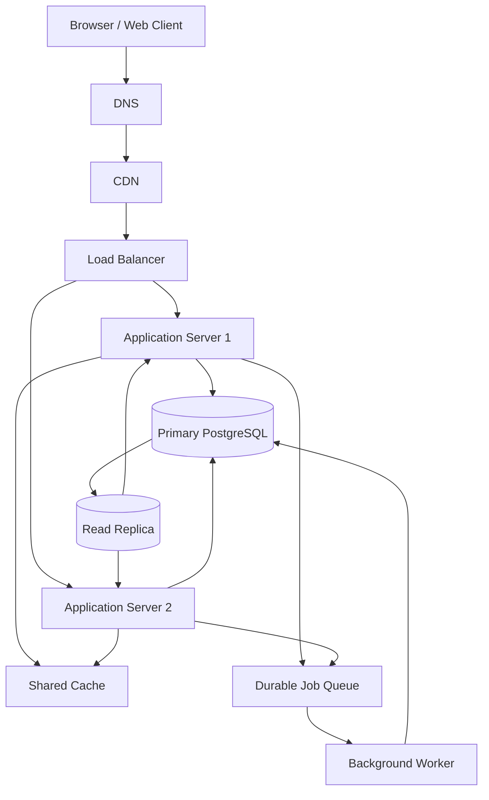

# QuickNotes System Architecture

## 1. Overview

QuickNotes is moving from a browser-only demonstration to a production online service. The design targets one million registered users and provides secure access to notes, reliable storage and the ability to scale as traffic grows.

The browser demonstration uses JSONPlaceholder. The production system described here uses a real backend API and PostgreSQL database.

## 2. Functional Requirements

1. Users can register and sign in securely.
2. Authenticated users can create, read, update and delete their own notes.
3. Users can organise notes with tags.
4. Users can search and paginate through their notes.
5. The API returns consistent success and error responses.
6. Users cannot read or change another user's private notes.
7. Users can access the service through a web browser.

## 3. Non-Functional Requirements

- **Scalability:** Support one million registered users and scale application servers horizontally.
- **Availability:** Target 99.9% monthly service availability.
- **Performance:** Aim for a p95 response time below 300 ms for ordinary note reads under expected load.
- **Security:** Use HTTPS, secure password hashing, token-based authentication, input validation and per-user authorisation.
- **Durability:** Persist note changes in a reliable primary database with tested backups and recovery procedures.
- **Maintainability:** Separate the client, API, data access and background processing responsibilities.
- **Observability:** Collect logs, metrics, traces and alerts for failures and slow requests.

These targets must be verified through load testing and operational monitoring.

## 4. Load Estimates for One Million Users

### Assumptions

- Registered users: 1,000,000.
- Daily active users: 20% = 200,000.
- Each active user performs 50 read operations and 5 write operations per day.
- Average stored note content and metadata: 2 KB per note.
- Average new notes: 2 per active user per day.
- The year has 365 days.
- Estimates initially exclude indexes, replicas, backups and additional database overhead.

### Reads per second

Daily reads:

200,000 × 50 = 10,000,000 reads per day.

Average reads per second:

10,000,000 ÷ 86,400 ≈ 116 reads per second.

### Writes per second

Daily writes:

200,000 × 5 = 1,000,000 writes per day.

Average writes per second:

1,000,000 ÷ 86,400 ≈ 12 writes per second.

### Storage per year

New notes per day:

200,000 × 2 = 400,000 notes per day.

New notes per year:

400,000 × 365 = 146,000,000 notes per year.

Estimated raw storage:

146,000,000 × 2 KB = 292 GB per year, using decimal units.

This is an approximate estimate for note records only. Actual capacity planning must include database indexes, replicas, backups, logs, user and tag records, and growth in note size.

Peak traffic may be several times the daily average, so capacity should be tested above the estimated average.

## 5. Architecture Diagram



The diagram is a logical overview. Production routing, failover and network access must be configured securely.

## 6. Components and the Problems They Solve

- **Browser / Web Client:** Provides the user interface for creating and managing notes without requiring direct database access.
- **DNS:** Resolves the service domain to the appropriate network endpoint.
- **CDN:** Delivers static files from nearby edge locations, reducing latency and origin traffic.
- **Load Balancer:** Distributes incoming API requests across healthy application servers.
- **Application Server 1:** Validates requests, authenticates users and implements API business logic.
- **Application Server 2:** Provides additional capacity and allows requests to continue when one application server fails.
- **Shared Cache:** Stores suitable frequently accessed data to reduce repeated database reads and improve response time.
- **Primary PostgreSQL Database:** Provides the authoritative, transactional store for users, notes, tags and relationships.
- **Read Replica:** Serves suitable read-only queries to reduce pressure on the primary database.
- **Durable Job Queue:** Buffers background tasks so temporary worker slowdowns do not block all user requests.
- **Background Worker:** Processes asynchronous work such as notifications, exports and maintenance tasks.

## 7. GET /notes Request Flow

1. The browser sends `GET /v1/notes?page=1&limit=20` with its access token.
2. DNS resolves the QuickNotes domain, and the CDN handles any cacheable static content; private API responses are not publicly cached.
3. The load balancer forwards the API request to a healthy application server.
4. The application server validates the token and confirms the user is authorised.
5. The server checks the shared cache for an appropriate user-specific result.
6. On a cache miss, the application queries PostgreSQL or a sufficiently up-to-date read replica.
7. The database returns the user's notes, ordered and paginated.
8. The application formats the JSON response, applies suitable cache rules and returns it to the browser.
9. The browser displays the notes and reports success or an appropriate error.

Private note responses must not be shared between users through a misconfigured cache. Cache invalidation and stale replica data must be handled deliberately.

## 8. POST /notes Request Flow

1. The browser sends `POST /v1/notes` with an access token and a JSON body containing the title and optional body.
2. The load balancer forwards the request to a healthy application server.
3. The server authenticates the user and validates the title, request size and content type.
4. The server writes the new note to the primary PostgreSQL database in a transaction.
5. The database generates the note ID and confirms the committed write.
6. The application invalidates or updates relevant cached note lists.
7. The application returns `201 Created`, the saved note and a `Location` header.
8. The browser adds the returned note to its interface and shows a success message.
9. If an asynchronous follow-up task is needed, the application publishes it to the durable queue, using a reliable delivery pattern such as a transactional outbox when required.

The API must not report successful durable creation before the database transaction commits.

## 9. Trade-Offs

### SQL vs NoSQL

PostgreSQL provides relational integrity, transactions and joins for users, notes and tags. A document database may offer flexible document structures, but maintaining ownership and many-to-many relationships would require additional application logic. PostgreSQL is the better initial fit.

### Cache speed vs consistency

Caching reduces database load and improves read performance, but cached results can become stale. QuickNotes should invalidate affected user-specific cache entries after writes and avoid caching sensitive responses publicly.

### Read replicas vs immediate consistency

Read replicas improve read capacity but may lag behind the primary database. Newly created or updated notes should be read from the primary when immediate consistency is required.

### Background processing vs simplicity

A queue keeps slow background tasks out of user-facing requests, but it adds infrastructure and operational complexity. Only suitable asynchronous work should use the queue, with retries, monitoring and dead-letter handling.

## 10. Avoiding Single Points of Failure

- **Application servers:** Run at least two instances across separate failure zones and let the load balancer remove unhealthy instances.
- **Load balancer and DNS:** Use managed, highly available services with health checks and appropriate DNS failover.
- **Cache:** Use a highly available shared cache where justified; the API should degrade gracefully if the cache is unavailable.
- **Database:** Use automated backups, point-in-time recovery, monitoring and a tested primary failover process with a standby or promotable replica.
- **Queue and workers:** Use a durable replicated queue and multiple worker instances so jobs can resume after a worker failure.
- **CDN and static assets:** Use a resilient provider configuration and keep deployment artifacts available for recovery.

A read replica is not automatically a complete backup or guaranteed failover solution. Database recovery, replication promotion and restoration must be tested regularly.

## 11. Monitoring and Growth Plan

Monitor request rate, latency percentiles, error rate, database connections, query latency, cache hit rate, queue depth and worker failures.

Begin with measured traffic and load tests. Scale application servers horizontally when CPU, latency or request queues indicate pressure. Tune indexes and queries before increasing database capacity. Add replicas, cache capacity and partitioning only when measurements justify them.

Review the estimates using real usage data after launch. One million registered accounts alone does not determine capacity; active users, usage patterns, peak traffic and stored content are the important variables.
```

### 14.3 Commit and push

Run these commands in your terminal:

```bash
git add docs/architecture.md
git commit -m "Add architecture doc"
git push origin main
```

You should now have seven meaningful commits if each earlier task was committed separately.

**Your turn:** Tell me when the architecture document has been pushed. Then we'll finish Task 7 with the README, verify the repository files and check your submission URL.
